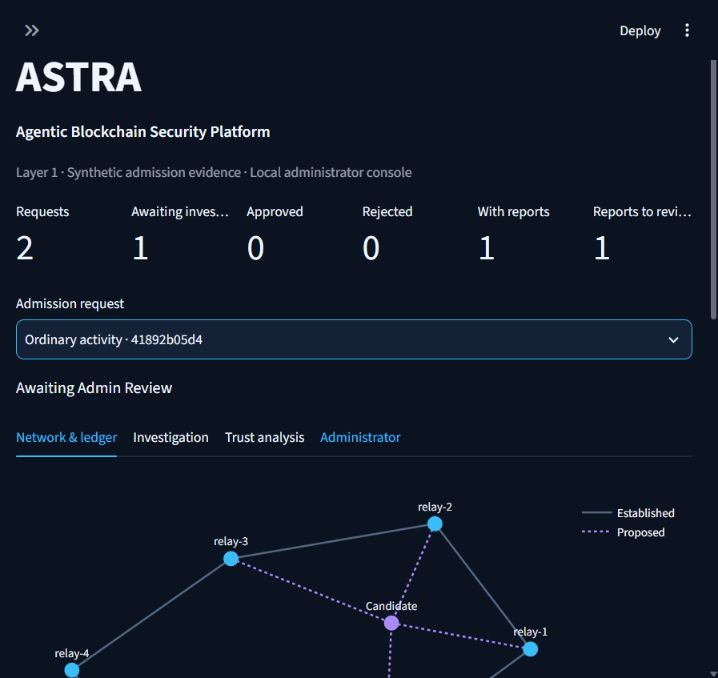

# ASTRA

ASTRA is a local simulator for a permissioned blockchain. Layer 1 investigates candidate admission with LangGraph and records administrator decisions in SQLite. Layer 2 evaluates rolling windows of synthetic post-admission telemetry.

## Run on Windows

Python 3.11 is the development baseline. From the project root in PowerShell:

```powershell
python -m venv .venv
.\.venv\Scripts\python.exe -m pip install -r requirements.txt
.\.venv\Scripts\python.exe -m streamlit run dashboard.py
```

Open `http://127.0.0.1:8501`. Choose a synthetic scenario in the sidebar, submit a request, and run the investigation. Review the network, specialist findings, and trust calculation before entering an administrator decision and note.



To start the optional FastAPI interface:

```powershell
.\.venv\Scripts\python.exe -m uvicorn astra.api:app --host 127.0.0.1 --port 8000
```

Open `http://127.0.0.1:8000/docs` for the API. The API and dashboard share the database selected by `ASTRA_DB`. The decision endpoint requires `Authorization: Bearer <ASTRA_ADMIN_TOKEN>`. Streamlit serves as the trusted local administrator console.

## Enable LLM investigations

Copy `.env.example` to `.env` and enter your OpenAI API key in `ASTRA_API_KEY`. The template selects `gpt-5.4-mini`, which supports Chat Completions and function calling. You can change `ASTRA_MODEL` to another tool-capable model. Set `ASTRA_BASE_URL` for an alternative Chat Completions-compatible endpoint. [OpenAI model documentation](https://developers.openai.com/api/docs/models/gpt-5.4-mini)

With no configured model, ASTRA still produces verified ledger and model-derived anomaly evidence. Specialist statuses show `model_unconfigured` and the recommendation is `MORE_EVIDENCE`. The dashboard displays tool actions and structured conclusions.

### Run with local Ollama

The Windows demo also supports the CPU-only `astra-qwen3-small` Ollama alias built from `qwen3:1.7b`. Set `ASTRA_MODEL=astra-qwen3-small` and `ASTRA_BASE_URL=http://127.0.0.1:11434/v1` in `.env`, then restart Streamlit. ASTRA uses the local Ollama placeholder credential at that address. The dashboard shows the current stage of an investigation.

The local model calls each specialist's evidence tool and then submits a schema-validated finding and confidence. ASTRA links the recorded evidence and translates the model's selected category into the prototype's numeric risk scale. The categories map to 0.05 for no observed indicator, 0.25 for weak, 0.50 for moderate, and 0.85 for strong. Inconclusive findings leave risk unavailable.

In the live seed-41 checks, the ordinary candidate produced a Trust Factor of 0.949. The unusual-wallet, coordinated-identity, and concentrated-peer checks each produced a risk of 0.85 in the relevant specialist. Their scores exceeded 0.70 under the original weighted formula. The revised formula uses the highest specialist risk as described below. The conflicting-spend and sparse-evidence cases requested more evidence. The administrator's decision was verified using a temporary database copy.

## How an investigation works

1. **Registration.** The simulator creates an Ed25519 identity, derives the node ID from its identity public key, and signs the association with a separate wallet public key. Candidate traffic is represented by historical observations. The six established replicas hold independent in-process ledger state and relay validated blocks through a fixed peer graph.
2. **Evidence.** The simulator builds a per-request ledger snapshot. It validates signatures, balances, sequential account nonces and block links. NetworkX provides funding relationships and peer topology. Isolation Forest compares four wallet features against 160 ordinary seeded histories. The lower-tail percentile reports the proportion of baseline scores at or below the candidate's score.
3. **Investigation.** The Supervisor selects the dispatch order. LangGraph checks coverage of wallet, Sybil, Eclipse and Finney dimensions. Each specialist can request read-only evidence tools, with a limit of four model turns. The application checks evidence references and validates output fields. The Supervisor reviews the findings for uncertainty or conflict.
4. **Trust.** The application calculates the prototype formulas below. Missing scores, confidence below 0.5, or a request for follow-up prevent an overall score. The decision and resulting membership status are written by the administrator.

| Value | Formula |
| --- | --- |
| Attack risk | `0.30S + 0.20W + 0.20F + 0.30E` |
| Positive trust | `0.25I + 0.20T + 0.20N + 0.20H + 0.15B` |
| Original Trust Factor | `0.60PT + 0.40(1 - AR)` |
| Adjusted attack risk | Let `Rmax = max(S, W, F, E)`. Use `max(Rmax, 0.76)` for an observed spend conflict or `Rmax >= 0.75`. Otherwise use `0.50AR + 0.50Rmax`. |
| Current Trust Factor | `0.60PT + 0.40(1 - adjusted attack risk)` |

The positive inputs are identity signature validity, replica validation, distinct proposed peer groups divided by proposed degree, transaction history count capped at six and normalized to one, and the wallet score's lower-tail percentile. The prototype formula threshold is 0.70. A strong indicator pushes the maximum possible completed score to 0.696, even with positive trust of one. A separate escalation appears for a specialist risk of at least 0.75 or an observed spend conflict. The review gate remains a fallback for a legacy report that lacks inputs for recalculation. Missing scores still return `MORE_EVIDENCE`. The administrator makes the final decision. Saved reports are read through the current policy without rewriting archived records. These inputs and weights are design assumptions. The percentile and LLM risk scores have no calibrated probability interpretation.

The pre-admission tools also expose measured funding and counterparty relationships, within-cluster payments, account age in simulated ticks, wallet bursts and repeated amounts, group-level peer HHI and independent routes, and counts of distinct recipient observations for each wallet nonce. An observed spend conflict earns 0.85 risk on the prototype's strong-indicator scale once the Finney specialist retrieves the evidence. That score feeds the Trust Factor while private-block attribution is recorded as unverified. Fields for unavailable telemetry are null. The simulator does not supply Ethereum reverts, real ASN metadata or private-block publication records.

## Tests and experiments

```powershell
.\.venv\Scripts\python.exe -m pytest -q
.\.venv\Scripts\python.exe -m astra.experiment --seed 41 --output evidence.json
.\.venv\Scripts\python.exe -m astra.experiment --scenario normal --live-model --output live-evidence.json
```

The experiment records synthetic ground truth, tools and evidence, elapsed time, recommendation, and any trust score. It leaves the administrator decision empty. The seeded cases cover normal behavior, funding alignment, peer concentration, anomalous wallets, conflicting spends, and sparse histories. Integration tests exercise tool invocation and review with a controlled model test double, including timeout and follow-up behavior.

The included evidence records capture all six seed-41 cases in evidence-only mode. The ordinary wallet had a lower-tail percentile of 0.65625. The abnormal wallet had a percentile of 0. All six cases requested more evidence because no live specialist scores were available. [Evidence records](evidence.json)

The Windows verification run on Python 3.11.7 finished with `16 passed in 25.14s`. The browser check also verified candidate submission, a completed evidence-only investigation, and replica agreement on the dashboard.

## Demo and viva

- Start with an ordinary candidate. Present replica agreement, the LLM's dispatch order, tool references, and the trust inputs. Enter and record an administrator note.
- Repeat with the concentrated peer or unusual wallet scenario. Explain what the evidence indicates and where uncertainty remains.
- Show the conflicting-spend case and explain what evidence would be required to draw a conclusion about private mining.
- Explain what each trust input measures, why confidence and risk are tracked separately, and where human approval enters the workflow.

## Layer 2 post-admission monitoring

Select an approved candidate, open **Post-admission monitoring**, and record a ten-observation synthetic batch. A node with fewer than ten observations is still in its observation period. ASTRA evaluates the most recent ten observations on each subsequent ingest and retains the observation, timestamp, and resulting report in SQLite. Repeated IDs with the same payload are idempotent. Reuse of an ID with different telemetry is rejected. Membership is controlled by the admission workflow, and monitoring findings are advisory.

| Check | Evidence and prototype threshold |
| --- | --- |
| Majority concentration | Member contributed more than half of the accepted blocks, with at least 20 accepted blocks in view. Block production share is an observed proxy for concentration. |
| Double spending | The observer reports at least one conflicting spend. The report does not establish that both spends settled. A positive observation is preserved even if other samples lack conflict telemetry. |
| Selfish mining | Competing tips and clustered arrivals coincided in at least two samples. The observation does not establish private behavior or intent. |
| Block withholding | Reported pool yield is below 20% of the supplied expectation, with at least five expected blocks. Variance and telemetry loss are alternative explanations. |

Each synthetic fixture supplies typed transaction-linked measurements, and each finding references the observations that support it. These Layer 2 checks are deterministic evidence evaluations. Layer 1 uses the local or hosted LLM for its admission investigations. The Layer 2 simulator evaluates telemetry when it is supplied. It has no external network listener or background blockchain collector, and no real mining or attack execution.

Layer 2 also reports a Wilson lower bound for observed block share and optional reorganization, confirmation-reversal, stale-block and delayed-publication counts when supplied. These are observed measurements, with coverage counts for the optional fields. Choose **Explain with LLM** to have a model request the selected finding through a read-only evidence tool, summarize its limits and suggest what evidence would clarify it. This optional explanation is held in the dashboard session. The numeric checks and saved evidence remain available with no model configured.

To remove a member after reviewing the evidence, open **Administrator**, enter a reason, and select **Revoke membership**. The node becomes `REVOKED`, leaves the active topology immediately, and receives no further observations. Its investigation, monitoring data and audit history remain available. The optional API exposes `POST /members/{node_id}/revoke` with a `note` and the administrator bearer token.

The API exposes `GET /members/{node_id}/monitoring` and `POST /members/{node_id}/monitoring/observations`. The POST requires the same administrator bearer token as admission decisions. The request takes a unique `observation_id` plus optional nonnegative telemetry counts. The interactive API docs list all fields. Omitted measurements are treated as missing evidence.

## Scope and limitations

The authority-produced ledger and relay network are in-process simulations. Approval adds the node to the persistent network roster and establishes its observed links to the initial relays. Approvals without observed relay links use the trusted bootstrap relay. Each subsequent investigation builds independent ledger replicas for the initial relays and all approved nodes, then validates block propagation across that topology. **Network & ledger** shows current membership and the selected investigation’s ledger snapshot. Synthetic keys derived from a seed and peer-group labels are fixtures. Peer proposals and spend conflicts are observer records. The Finney dimension assesses the observed spend-conflict proxy. A process termination during investigation can leave that request marked as running.

Model credentials and live model access are required to validate provider behavior and measure detection performance on held-out scenarios. The synthetic evidence tests establish the presence of scenario indicators. Production admission, real network telemetry, and detection benchmarks require further work.

[LangChain OpenAI configuration](https://docs.langchain.com/oss/python/integrations/llms/openai)
